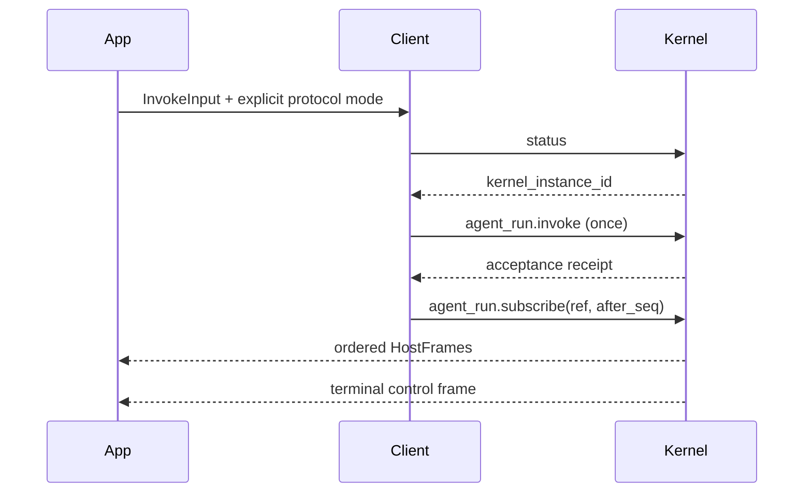

# Protocol Design

## Service Boundary

Octo Runtime is an independently installed local service. Applications install and start it with `npm install -g @mininglamp-oss/octo-runtime` and `octo-runtime executor-kernel start`. These clients attach to the actual Kernel endpoint. They do not import Runtime source, link its SDK, start a worker, or own its process.

The implementation targets Kernel IPC v2, Run contract v7 and AgentEnv in the `octo.context-envelope/v3` format. See the [public Kernel IPC reference](https://github.com/Mininglamp-OSS/octo-runtime/blob/main/docs/en/reference/kernel-ipc.md) and [Context catalog](https://github.com/Mininglamp-OSS/octo-runtime/blob/main/docs/en/reference/contexts.md).

## Generated and Handwritten Code

Identity models, protocol mode enums and method names are generated from the small, independent [client contract](protocol-contract.json). [Generation provenance](protocol-provenance.json) records the contract revision and SHA-256. These declarations are a deliberately limited subset, not a claim of implementing every upstream schema validator.

The standalone generator runs in a temporary workspace outside the four library repositories. Only generated artifacts and the contract record are committed. No generator, temporary directory, schema download, upstream checkout or Runtime package is needed to build or run these clients. Changing a protocol requires reviewing the contract, regenerating, formatting, and rerunning local checks. A digest proves a shared generation input; it is not proof of full wire compatibility.

Connection handling, submission, recovery, cancellation and streaming are independently implemented in each language. There is no vendored upstream client implementation. Project code is MIT-licensed.

## Transport and Framing

The supported transport is a Unix domain socket on macOS/Linux. Each connection sends one UTF-8 JSON-RPC 2.0 request terminated by LF. IDs are unique nonempty strings. Unary calls close after the response; subscriptions keep reading notifications on that connection.

One message may span multiple reads, and one read may contain multiple messages. Read complete LF-delimited lines before parsing JSON. Requests are capped at 32 MiB and response lines at 42,008,576 bytes. Streaming is pulled by the consumer; connection budgets are bounded. These are client resource limits, not an application sandbox.

```json
{"jsonrpc":"2.0","id":"status-1","method":"status","params":{}}
```

A response must match the request ID and contain exactly one of `result` or `error`. Business errors are identified by the stable string `error.data.code`, retaining unknown remote codes rather than matching human-readable messages.

## RPC Methods

| Method | Params | Result |
| --- | --- | --- |
| `status` | `{}` | Kernel instance, readiness and optional service process snapshots |
| `adapter.list` | `{}` | Registered Adapter metadata |
| `agent_run.invoke` | `{input, kernel_instance_id?}` | `{kernel_instance_id, receipt}` |
| `agent_run.get` | `{key, kernel_instance_id?}` | Original ref, retained range, optional terminal frame |
| `agent_run.subscribe` | `{ref, after_seq}` | Snapshot ACK, then `agent_run.event` notifications |
| `agent_run.cancel` | `{ref, reason?}` | `{accepted}`; acceptance is not completion |
| `agent_run.respond` | `{ref, response}` | Canonical interaction acceptance |
| `agent_run.native.respond` | `{ref, response}` | Provider-native interaction acceptance |

Rust additionally exposes environment overrides through its lower-level submission API. The libraries intentionally do not promise full feature parity with upstream SDKs.

## Identity and Lifecycle

An invocation input uses camelCase `runId`, `invocationId`, `sessionId` and `sessionGeneration`. The lookup key uses `run_id`, `invocation_id`, `agent_session_id`, `session_generation` and `protocol_mode`.

The accepted `RunRef` adds `kernel_instance_id`, `stream_id` and `protocol`. Save the complete receipt. Never reconstruct it from a business session name, substitute another run, or continue across a Kernel restart.



New convenience invocations get fresh execution, invocation and session IDs. Reusing a Provider session requires an explicit full input; these examples do not silently share conversation history.

## Canonical and Native Modes

The `invoke` methods select **canonical** mode. Their explicitly named native variants select **native** mode. Full-input APIs default to native when `protocol_mode` is omitted. Both modes yield complete HostFrames:

- Canonical: `{kind:"canonical", event:{...}, ...identity, seq}`. Read normalized event content from `event`.
- Native: `{kind:"native", messageKind, payload:{...}, ...identity, seq}`. Preserve Provider-specific details in `payload`.
- Control: `{kind:"control", control:{...}, ...identity, seq}`. A state control frame reports `completed`, `failed`, `cancelled` or `lost`.

A Provider payload containing the word "completed" is not an execution terminal. Inspect the control frame. DeepSeek Harness uses Adapter ID `dsh`; use canonical mode unless the installed Adapter advertises native support. Registered metadata does not prove installation, authentication, model availability or equivalent capabilities.

## Inputs and AgentEnv

The invocation contract follows upstream commit `c9d3bb6a642abce3177ac28cf9f26993909c3d32` (#352). Only `inputs` and `agentEnv` are required:

```json
{
  "inputs": [
    {"type":"text","text":"Application instructions and caller-owned history"},
    {"type":"text","text":"Current question"}
  ],
  "agentEnv": {"schema":"octo.context-envelope/v3","items":[]}
}
```

The caller supplies the complete ordered text/image parts. The client snapshots and forwards them without assembling business context or adding prompts. Execution settings use `agentEnv`, which retains the upstream v3 envelope format (at most 32 items and 65,536 UTF-8 bytes). Empty items are valid; the Runtime selects its default Adapter. Private payloads and item order pass through unchanged. An explicit Adapter, MCP, environment variables and execution policy belong here.

There is no `contexts` field or compatibility alias. Removed `controlInstructions` fields and `octo.control/instructions` items must be replaced by ordinary text parts in `inputs`. The client does not merge default items or add an approval policy. Text convenience calls only construct one text part and an Adapter item. In playboard, `--agent-env` with `--prompt` supplies the entire environment; `--adapter` is used only when no environment file is supplied.

Images use PNG, JPEG or WebP, at most 2 MiB each, with `mimeType`, base64 `data`, `byteSize` and lowercase `sha256`. Image helpers compute metadata from caller-owned bytes. Provider support is required.

## Recovery and Cancellation

If an acceptance ACK is lost or malformed after a possible write, query the original lookup key and observed Kernel instance with bounded attempts. **Never automatically replay invoke.** If acceptance cannot be established, return `RUN_OUTCOME_UNKNOWN` with the original lookup information.

Subscription reconnects use the same full ref and last validated cursor. Validate the snapshot's retained window, instance, run identity, consecutive sequence, and agreement between notification and HostFrame sequence. Gaps and identity changes fail. A consumed terminal cursor completes without replaying terminal output. This is bounded recovery over an in-memory Kernel cache, not durable execution storage.

Lost cancellation or interaction acknowledgements produce `OPERATION_OUTCOME_UNKNOWN`. Do not automatically replay a side effect. A cancellation ACK means only that the request was accepted; observe the terminal state for the outcome.

Closing a client, dropping an iterator or aborting observation releases local IO; it does not cancel accepted execution or stop the service. Retain the receipt and explicitly cancel when required. The playboards use execution deadlines to request cancellation and observe a short tail. The independent clients do not implement a managed invocation registry or automatic owner drain.

## Validation

Run unit/protocol tests locally, then test an already-running Kernel and authenticated Provider. The real-Provider smoke records canonical/native completion and receipt handling without committing raw output or credentials. Live Codex results do not establish support for every harness, Windows, recovery after service restart, or sustained load. No GitHub workflow or CI gate is introduced.
